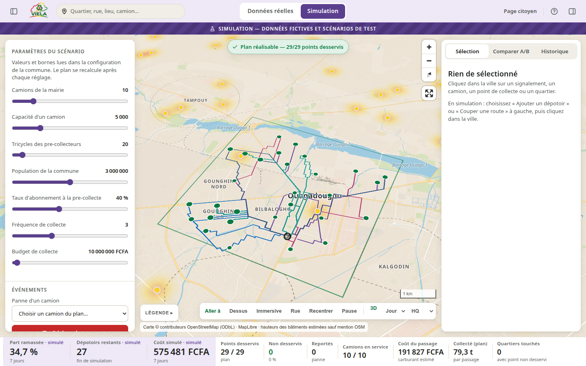
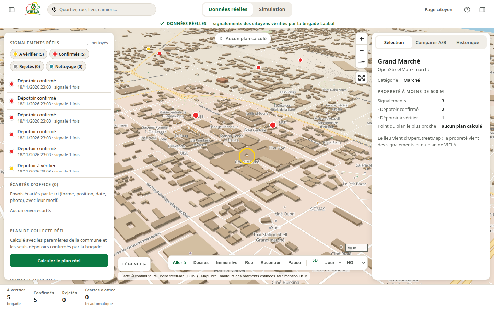
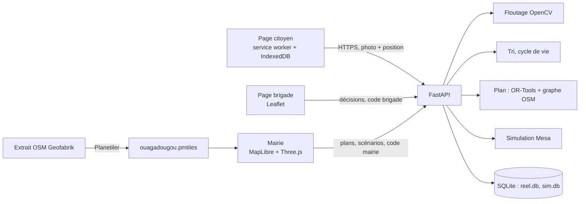

# VIELA

**Plateforme numérique de gestion et de suivi de l'assainissement urbain à Ouagadougou**
Rapport technique et de présentation du projet. Hackathon des Universités 2026, finale, thème l'Open Source, sujet 01 « Assainissement de Ouaga ».
Équipe (auteurs du dépôt git) : jonathan-onjd, TaniaW777, Christelle Dehoumon. *Noms complets, établissement et encadrement : à compléter.*
Code : https://github.com/christelle-dehoumon/yilgre (licence Apache-2.0). État décrit : 18 novembre 2026. Identifiant technique : `yilgre` (anciens noms : Yilgré, Ouaga Clean).

## Résumé exécutif

À Ouagadougou, les dépotoirs sauvages se forment là où la pré-collecte ne passe pas ou déborde. La mairie, la brigade Laabal et les citoyens n'ont pas de vue commune pour décider où intervenir. VIELA relie les trois : le **citoyen** signale un dépotoir par une photo géolocalisée, sans compte ; la **brigade** confirme ou rejette sur place ; la **mairie** voit les cas confirmés sur une carte 3D de toute l'agglomération, calcule un plan de collecte (points de regroupement, tournées de camions) et teste des scénarios : panne, saison des pluies, nouveau quartier, route coupée.

L'application est un logiciel libre, auto-hébergé, sans service cartographique payant. Les signalements, décisions et plans calculés sont réels ; les camions animés, les cas de démonstration et la simulation des ménages sont **simulés** et étiquetés comme tels à l'écran. Les résultats ci-dessous ne viennent que de tests et de mesures relancés sur le dépôt.

## 1. Contexte, problématique et objectifs

Le sujet demande de cartographier les dépotoirs à partir de signalements vérifiés, de proposer un plan de gestion, de simuler les acteurs et de garder un plan cohérent lors d'épreuves en direct (signalements piégés, panne, pluie, nouveau quartier). Les difficultés traitées sont générales à une municipalité : localiser les dépôts, centraliser des remontées citoyennes fiables, organiser des tournées, réagir aux incidents. Aucune statistique locale n'est avancée faute de source vérifiée.

**Objectifs :** (1) une remontée citoyenne simple, même sans réseau ; (2) une vérification terrain qui filtre les faux signalements ; (3) une aide à la décision cartographique et chiffrée pour la mairie ; (4) un bien commun réutilisable (code libre, export ouvert des dépotoirs vérifiés).

**Acteurs :** citoyens (aucun compte), brigade Laabal (code d'accès), mairie (code d'accès).

## 2. Fonctionnalités et état réel

| Fonctionnalité | État | Preuve |
|---|---|---|
| Signalement citoyen : photo + position GPS automatique, file hors connexion (IndexedDB), envoi au retour du réseau | Implémentée et vérifiée | test navigateur `citizen_test` (en ligne, hors ligne, rechargement hors ligne, synchronisation) |
| Caméra directe (caméra arrière), repli sur la prise de photo native si refus ou absence | Vérifiée en navigateur avec caméra simulée ; **non testée sur téléphone réel** | test 8/8 (caméra simulée par Chromium, refus) |
| Tri automatique des envois : doublons, photo déjà vue, près d'un plan d'eau, hors secteur, GPS imprécis, envois écartés avec motif | Implémentée et vérifiée | `tests/test_triage.py`, `test_lifecycle.py` |
| Brigade : liste des cas, fiche avec photo floutée, confirmer / rejeter, décisions hors ligne, conflits, carte des cas ouverte sur clic | Implémentée et vérifiée | `brigade_test`, test carte brigade 8/8 |
| Mairie : carte 3D MapLibre de toute l'agglomération, recherche locale, « Aller à » + visite guidée, ambiances jour / doré / soir / nuit, mode léger | Implémentée et vérifiée | scénario carte 15/15, tests 6/6 et captures |
| Zones prioritaires : densité des signalements à traiter | Implémentée et vérifiée | test 3/3, capture 1 |
| Plan de collecte réel (cas confirmés) et plan de simulation : points de regroupement, tournées OR-Tools sur le réseau OSM | Implémentée et vérifiée sur le secteur pilote et 3 quartiers | `test_a_plan.py`, `dash_full` |
| Panne de camion (recalcul partiel, arrêts reportés), saison des pluies, nouveau quartier, coupure de route, comparaison A/B, historique | Implémentée et vérifiée | `dash_full` 24/24, scénario carte 15/15 |
| Simulation des acteurs (ménages, pré-collecteurs, brigade, mairie ; Mesa) : part ramassée, coût, dépotoirs restants | Implémentée ; hypothèses non mesurées | `tests/test_sim.py` ; coefficients dans la configuration |
| Floutage visages et plaques | **Partielle** : côté serveur seulement (§ 3) | `docs/mesures.md` |
| Export ouvert GeoJSON / OSM (cas confirmés, sans photo, ODbL) | Implémentée et vérifiée | test `gestes` |
| Lancement en une commande (`./scripts/lancer.sh`) | Implémentée et vérifiée sur ce poste | démarrage à neuf et réutilisation testés |
| Positions GPS réelles des camions, temps réel poussé par le serveur, routage sur toute l'agglomération, monuments 3D, simulation animée des pré-collecteurs | **Non implémentés** | — |

*Capture 1. Mode Simulation : tournées calculées par OR-Tools sur les vraies rues, points de regroupement, indicateurs simulés (bandeau violet), zones prioritaires en halos.*

**Cartographie.** La carte couvre l'agglomération (longitude −1,72 à −1,36, latitude 12,20 à 12,53) à partir de l'extrait OpenStreetMap de Geofabrik, transformé par Planetiler en un fichier PMTiles de 16 293 582 octets servi par l'application elle-même : 385 359 bâtiments, routes par classe, eau, espaces verts, lieux et points d'intérêt. **Seuls 12 bâtiments ont une hauteur dans OSM et 241 un nombre d'étages** : les autres hauteurs sont estimées selon le type OSM, et la fiche de chaque bâtiment indique l'origine de sa hauteur. Les textures de façade (Poly Haven, CC0) et les ombres portées sont stylistiques. La couverture OSM est inégale (5 462 bâtiments sur une tuile du centre contre 455 à Tampouy) : un quartier vide peut être un quartier peu cartographié. Les tournées ne se calculent que sur le secteur pilote et trois quartiers téléchargés.

*Capture 2. « Aller à » le Grand Marché : bâtiments OSM extrudés, et propreté à moins de 600 m (signalements par statut, point du plan le plus proche).*

## 3. Protection des photographies

**Ce qui existe.** Le serveur floute visages et plaques **avant tout enregistrement** (`core/privacy.py`) : la photo reçue reste en mémoire, la détection utilise les cascades Haar d'OpenCV (aucun modèle téléchargé), chaque zone est élargie puis floutée fortement et pixellisée, et seule l'image réencodée en JPEG est écrite, ce qui supprime les métadonnées EXIF. Si la détection échoue, **toute l'image est floutée** et le cas reçoit l'alerte « Floutage non vérifié ». La brigade et la mairie ne voient que la version floutée. Côté navigateur, la photo est redessinée sur un canvas (1 024 px, JPEG 0,8) avant envoi, ce qui retire aussi l'EXIF.

**Mesures** (`docs/mesures.md`, 7 images de test) : 7/7 visages sur une photo de groupe, 1/1 en portrait, 1/1 et 2/2 plaques sur deux voitures, **0/1 sur un gros plan de plaque** (cas limite manqué).

**Ce qui manque.** La détection ne se fait pas dans le navigateur : l'image envoyée au serveur, sans EXIF, n'est **pas encore floutée**, et le citoyen ne voit pas d'aperçu anonymisé avant l'envoi. Les cascades Haar sont anciennes, et le détecteur de plaques a été entraîné sur des plaques russes. L'anonymisation n'est donc pas garantie parfaite.

## 4. Architecture technique

| Couche | Technologies (vérifiées dans le dépôt) | Rôle |
|---|---|---|
| Interfaces | HTML, CSS, JavaScript natif (modules ES), sans framework ni compilation | trois pages : citoyen, brigade, mairie |
| Carte | MapLibre GL JS 6.16, PMTiles 4.5, Three.js r170 (camions, ville 3D du secteur pilote), Leaflet 1.9 (vue 2D de secours, carte de la brigade) | rendu 2D / 3D, tous copiés localement (sans CDN) |
| Serveur | Python 3.12, FastAPI, SQLite (deux bases : réel et simulation) | API, rôles, cycle de vie des cas |
| Calcul | OR-Tools (tournées), osmnx, SciPy (plus courts chemins), Mesa (simulation), OpenCV (floutage) | plan de collecte, scénarios, vie privée |
| Données | OpenStreetMap (ODbL) via Geofabrik et Planetiler | bâtiments, routes, lieux |

**Sécurité.** Rôles par code d'accès (en-tête `X-Role-Code`, codes à définir par `MAIRIE_CODE` et `BRIGADE_CODE` en déploiement ; les codes de démonstration sont publics). HTTPS par certificat auto-signé. Les données réelles et simulées sont dans deux bases distinctes ; un cas simulé n'est jamais exporté. Limite constatée : la page de la mairie accepte un code brigade à la connexion, le serveur refuse ensuite les actions réservées à la mairie.

**Choix d'une application web.** Un seul code sert téléphones et ordinateurs, sans magasin d'applications, avec des mises à jour centralisées. La page citoyen fonctionne **hors connexion** (service worker, file d'envoi), mais l'application **n'est pas installable** comme une PWA complète : aucun manifeste n'est fourni. La carte 3D demande WebGL ; sans lui, une vue 2D de secours prend le relais. Les tuiles sont auto-hébergées pour que la démonstration ne dépende d'aucun service en ligne ; seule la carte de la brigade charge le fond OpenStreetMap en ligne.

## 5. Adopter, adapter, améliorer

| Adopter | Adapter | Améliorer |
|---|---|---|
| Cartes vectorielles libres (OSM, MapLibre, PMTiles), optimisation de tournées (OR-Tools) ; exploration urbaine de type Kutɔnu Vibes (ambiances, « Aller à », visite guidée), étudiée sans en copier de ressource | Ouagadougou entière depuis OSM, hauteurs estimées déclarées, palette sahélienne, brigade Laabal dans le circuit, saison des pluies et zones inondables, interfaces en français | Chaque lieu mène à l'état de la propreté alentour ; zones prioritaires ; la panne d'un camion recalcule le plan et nomme les arrêts reportés ; statut du plan jamais vert s'il reste un point non desservi |

## 6. Tests, mesures et limites

**Tests** (relancés le 18 novembre 2026) : `pytest tests` donne **128 passed**. La recette complète (`./scripts/verifier_tout.sh` : pytest et 10 parcours navigateur Playwright) passe **11/11** sur l'état de 19 h 55. Sur l'état de 20 h 16, elle donne 10/11 : le parcours `chaine` est instable sous charge, et il repasse **11/11** une fois relancé dans l'ordre de la recette. **Après ces deux recettes**, la caméra directe, la carte de la brigade, le logo et le nom VIELA ont été ajoutés. Ils ont été vérifiés par pytest (128) et par les parcours citoyen, brigade et démonstration, mais **la recette complète n'a pas été relancée depuis**.

**Mesures.**
- *Poste faible simulé* (rendu sans carte graphique, processeur ralenti ×4) : chargement de la carte en 4,6 s ; temps médian par image de 21 à 35 ms en haute qualité, de 20 à 26 ms en mode léger.
- *Calcul du plan* (`docs/mesures.md`, Intel i3-1115G4) : plan par défaut en 0,31 s ; recalcul partiel après une panne en 0,05 s, contre 0,31 s pour un calcul complet.

| Limite actuelle | Évolution envisagée |
|---|---|
| Tournées calculées sur le secteur pilote et 3 quartiers seulement | Étendre le graphe routier à l'agglomération (autorisé, non réalisé) |
| Camions animés et simulés, aucun GPS | Brancher des positions GPS réelles sur la même couche |
| Hauteurs estimées, couverture OSM inégale | Contribuer à OSM, ajouter Google Open Buildings |
| Floutage côté serveur seulement, détecteurs anciens | Détection dans le navigateur avec aperçu, modèle de plaques locales |
| Aucun test sur téléphone réel ni en conditions réelles | Expérimentation avec la brigade Laabal |
| Fichier de tuiles à fabriquer après clonage (Java 21+) | Distribuer un fichier déjà fabriqué |
| Dépotoirs légaux non représentés (aucune source fiable identifiée) | Liste officielle à fournir par la mairie |

## 7. Impact potentiel et conclusion

Pour le **citoyen**, signaler prend une photo et ne demande ni compte ni réseau. Pour la **brigade**, un tri automatique écarte les envois douteux avant le déplacement. Pour la **mairie**, une même carte relie les cas vérifiés, les tournées et les scénarios, avec des chiffres simulés toujours étiquetés. Aucun impact sur la propreté réelle n'est revendiqué : le projet n'a pas encore été expérimenté sur le terrain.

VIELA répond au sujet par une chaîne complète, du signalement au plan, testée de bout en bout en navigateur. Le code et les données sont ouverts, et l'application se lance en une commande. Les limites ci-dessus, en premier lieu le routage limité au secteur pilote et l'anonymisation côté serveur seulement, sont les priorités d'une suite.

**Annexes.** Captures complémentaires dans `docs/rapport/` : 01 zones prioritaires (données réelles), 03 bâtiments en ambiance dorée, 05 caméra citoyen (mobile, caméra simulée), 06 fiche brigade (mobile). Documentation : `docs/carte.md` (carte, données, licences), `docs/mesures.md`, `THIRD_PARTY_LICENSES.md`. Attribution : © contributeurs OpenStreetMap (ODbL).
