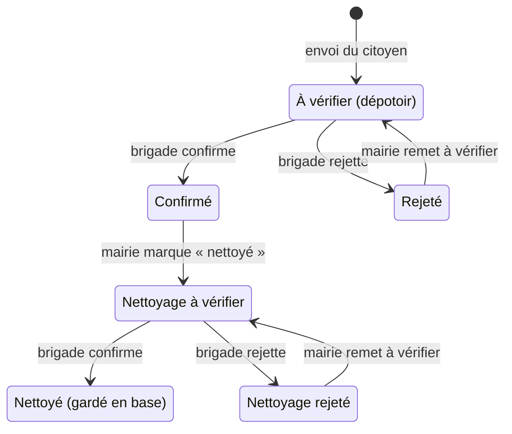
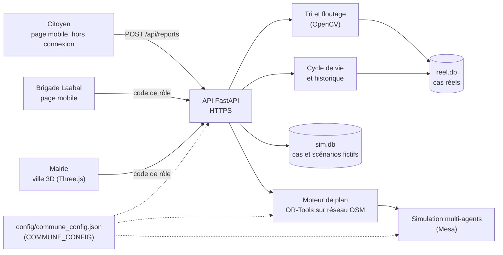

<p align="center">
  
</p>

<h1 align="center">Yilgré</h1>

<p align="center"><b>Outil libre d'aide à la décision pour l'assainissement : du signalement citoyen des dépotoirs sauvages au plan de collecte de la ville.</b></p>

<p align="center">
  <i>Hackathon des Universités 2026, finale, thème l'Open Source : sujet 01 « Assainissement de Ouaga »</i><br>
  <i>Engagement open source : adopter, adapter et améliorer des briques libres (OSMnx, OR-Tools, Mesa, Three.js) sur des données ouvertes (OpenStreetMap)</i>
</p>

<p align="center">
  <a href="LICENSE"></a>
  <a href="https://github.com/christelle-dehoumon/yilgre/actions/workflows/ci.yml"></a>
  <a href="THIRD_PARTY_LICENSES.md"></a>
  <a href="#7-open-source-et-bien-commun"></a>
  
</p>

---

## 1. En Bref

- **Le problème :** à Ouagadougou, les dépotoirs sauvages se multiplient alors que la collecte (pré-collecteurs, camions de la mairie, brigade Laabal) manque d'informations partagées pour décider où et comment intervenir.
- **Ce que fait Yilgré :** il recueille les signalements des citoyens, les fait vérifier sur place, calcule un plan de collecte (points de regroupement, tournées des camions) et simule les effets d'une décision avant de la prendre.
- **Pour qui :** le **citoyen** signale depuis son téléphone, même sans réseau ; la **brigade Laabal** vérifie sur le terrain ; la **mairie** pilote dans une ville en 3D, en données réelles ou en simulation.
- **Pour l'épreuve en direct :** panne d'un camion, saison des pluies, nouveau quartier, route coupée : le plan se recalcule et reste honnête sur ce qu'il ne dessert pas.
- **Bien commun :** code sous licence Apache-2.0, données OpenStreetMap (ODbL), jeu de signalements ouvert, réutilisable par une autre commune en changeant seulement sa configuration.

---

## 2. Démarrage Reproductible (Une Seule Commande)

### Prérequis
- Linux (testé sous Ubuntu 24.04), Python 3.12, OpenSSL.
- Une connexion Internet pour la première installation des paquets Python (les données géographiques sont dans le dépôt).
- Un navigateur récent ; pour la ville 3D, un ordinateur avec WebGL (sinon une carte 2D de secours s'affiche).

### 1. Cloner le dépôt
```bash
git clone https://github.com/christelle-dehoumon/yilgre.git
cd yilgre
```
> Le dépôt s'appelait auparavant `ouaga-clean` : GitHub redirige l'ancienne adresse après renommage.

### 2. Lancer
```bash
./scripts/run.sh
```
Ce script crée l'environnement Python, installe `requirements.txt`, génère un certificat HTTPS, initialise les bases `data/reel.db` et `data/sim.db` (avec un jeu de cas FICTIFS dans `sim.db` seulement), puis démarre l'application en HTTPS sur le port 8443.

### 3. Ouvrir
| Interface | Adresse | Accès |
|---|---|---|
| **Mairie, ville 3D** | `https://<ip-du-poste>:8443/dashboard/` | code mairie |
| **Brigade Laabal** | `https://<ip-du-poste>:8443/brigade/` | code brigade |
| **Signalement citoyen** | `https://<ip-du-poste>:8443/citizen/` | aucun compte |
| **API (documentation interactive)** | `https://<ip-du-poste>:8443/docs` | contrat : [docs/api.md](docs/api.md) |

| Rôle | Code de démonstration |
|---|---|
| **Mairie** | `mairie-demo` |
| **Brigade** | `brigade-demo` |

Ces codes sont publics : en déploiement réel, définir `MAIRIE_CODE` et `BRIGADE_CODE`. Ajouter `?mock=1` à une adresse affiche un mode démonstration à données fictives, signalé par un bandeau permanent.

### Téléphone et certificat
- **Accès :** le téléphone doit être sur le même réseau Wi-Fi ; l'adresse exacte est affichée au démarrage (`réseau local : https://…:8443/citizen/`).
- **Certificat auto-signé :** le navigateur affiche un avertissement à accepter une fois. GPS, caméra, envoi et file hors connexion fonctionnent ; la réouverture de la page sans réseau demande un certificat reconnu (voir les [limites](#10-limites-connues-et-transparence-technique)) : `SSL_CERTFILE=… SSL_KEYFILE=… ./scripts/run.sh`, ou `mkcert` installé.

### Remise à zéro et Docker
```bash
./scripts/reset_db.sh            # vide sim.db et recharge le jeu fictif (reel.db intact ; --reel pour la vider aussi)
docker compose up --build        # même application en conteneur (image yilgre:latest), https://localhost:8443/
```

---

## 3. Parcours de Démonstration (3 minutes)

1. **Signalement (citoyen) :** sur le téléphone, `/citizen/` : la position se remplit seule, prendre une photo, « Envoyer ». Couper le réseau, envoyer un second signalement : il reste sur le téléphone et part au retour du réseau.
2. **Vérification (brigade) :** sur `/brigade/`, ouvrir le cas (photo floutée par le serveur, alertes du tri), « Confirmer ».
3. **Ville et plan (mairie) :** sur `/dashboard/`, mode **Données réelles** : le dépotoir confirmé apparaît en rouge dans la ville 3D ; « Calculer le plan réel ».
4. **Simulation :** basculer en **Simulation** (bandeau jaune) ; points de collecte, tournées colorées, camions qui roulent sur leurs tournées ; onglet « Comparer A/B » > « Fixer le plan affiché comme A ».
5. **Panne :** cliquer un camion > « Déclarer en panne » : il s'arrête feux allumés ; recalcul partiel, arrêts reportés listés, temps de calcul serveur affiché.
6. **Pluie puis nouveau quartier :** « Déclencher la saison des pluies », puis ajouter Kalgodin : nouveaux points, quartiers touchés.
7. **Décider :** « Fixer le plan affiché comme B » > « Comparer A et B » : écarts de couverture, de coût et de points non desservis, compromis expliqués.

Script minuté de la vidéo : [docs/video_script.md](docs/video_script.md).

---

## 4. Fonctionnalités par Acteur

- **Citoyen :** une page, sans compte ; photo réduite à 1024 px ; position GPS automatique ; file locale IndexedDB et synchronisation automatique ; aucune réponse du tri affichée (« reçu » seulement).
- **Tri automatique (serveur) :** aide à la brigade, jamais décideur. Écarte d'office les envois impossibles (forme, position hors commune, date, photo) avec un motif visible de la mairie ; sinon transmet avec des alertes (doublon probable, photo déjà vue, près d'un plan d'eau, hors secteur, GPS imprécis). Un doublon (moins de 30 m et 48 h) renforce le cas existant (« signalé N fois »).
- **Floutage :** visages et plaques floutés côté serveur avant tout stockage (OpenCV) ; l'original n'est jamais écrit sur disque.
- **Brigade Laabal :** ne voit que les cas « à vérifier » (dépotoir ou nettoyage) ; confirme ou rejette ; décisions gardées hors connexion et synchronisées ; conflits signalés.
- **Mairie, données réelles :** ville 3D, couleur par statut, fiche avec photo et historique, « Marquer nettoyé », « Remettre à vérifier », envois écartés et remise, plan réel sur les seuls cas confirmés, exports ouverts.
- **Mairie, simulation :** paramètres bornés, panne d'un camion, pluie, nouveau quartier, dépotoir fictif et route coupée par un clic dans la ville, simulation multi-agents de 7 jours, comparaison A/B, historique des calculs.

### Cycle de vie d'un cas

Toute autre transition est refusée (HTTP 409). Chaque transition est écrite dans une table d'historique (qui, quand).

---

## 5. Architecture


Les deux bases ont le même schéma et ne sont jamais jointes : rien de simulé n'atteint `reel.db` ni un export.

```text
yilgre/
├── api/                 API FastAPI : cycle de vie, tri, plans, simulation, exports, rôles
├── core/
│   ├── lifecycle.py     machine à états et historique
│   ├── db.py            reel.db et sim.db (même schéma)
│   ├── validation/      tri automatique et grille anti-doublon
│   ├── privacy.py       floutage des visages et plaques
│   ├── geo/, optim/     réseau OSM, points de regroupement, tournées, événements
│   ├── sim/             simulation Mesa (ménages, pré-collecteurs, brigade, mairie)
│   └── config.py        seul lecteur de la configuration (COMMUNE_CONFIG)
├── web/
│   ├── citizen/         page citoyen (service worker, IndexedDB)
│   ├── brigade/         page brigade
│   └── dashboard/       ville 3D de la mairie (ville/), code partagé (shared/), Three.js et Leaflet (vendor/)
├── config/              commune_config.json (Ouagadougou), commune_config.koudougou.json
├── data/                réseau routier, bâtiments, eau, quartiers (OSM), jeux fictifs, exports
├── scripts/             run.sh, reset_db.sh, verifier_tout.sh, préparation des données, mesures
├── tests/               128 tests pytest (+ images de test du floutage)
├── assets/              logo
└── docs/                API, mesures, rapport technique, contribution, script vidéo
```

---

## 6. Choix Techniques : Adopter, Adapter, Améliorer

| Démarche | Brique ou choix | Ce que nous en faisons |
|---|---|---|
| **Adopter** | OSMnx, OR-Tools, Mesa, Three.js, Leaflet, FastAPI, OpenCV | briques libres reconnues, versions épinglées |
| **Adapter** | réseau OSM | quatre vues : camions / tricycles, temps sec / pluie (voies non revêtues ×2,5, voies près des cours d'eau coupées) |
| **Adapter** | acteurs de Ouagadougou | ménages, pré-collecteurs, brigade Laabal, mairie, avec des règles et hypothèses déclarées |
| **Adapter** | réglages par commune | toutes les valeurs dans un fichier ; Koudougou démontré par la seule configuration |
| **Améliorer** | plus courts chemins | SciPy en un appel au lieu de NetworkX source par source |
| **Améliorer** | cache des distances | matrice relue sans recalcul entre deux plans |
| **Améliorer** | recalcul partiel | après une panne, seuls les arrêts du camion perdu sont redistribués |
| **Améliorer** | présélection | au-delà de la capacité de la flotte, seuls les arrêts prioritaires vont au solveur |

Mesures réelles ([docs/mesures.md](docs/mesures.md), `python -m scripts.bench`, Intel i3-1115G4, 4 cœurs, sans carte graphique) :

| Mesure | Avant | Après |
|---|---|---|
| Dijkstra depuis 60 sources | 0,89 s (NetworkX) | 0,06 s (SciPy) |
| Placement des points (k = 46) | 0,13 s (26 397 bâtiments) | 0,03 s (1 741 cellules de 100 m), même couverture |
| Matrice 29 × 29 | 0,027 s à froid | 0,000 s avec le cache |
| Panne d'un camion | 0,31 s (calcul complet) | 0,05 s (recalcul partiel), 29/29 points servis |
| 100 signalements | 4,77 s, 70/92 points servis | 1,38 s, 67/92 points servis |
| 1 000 signalements | 5,28 s, 34/318 points servis | 1,03 s, 41/318 points servis |
| 10 000 signalements | 8,80 s, 34/2 747 points servis | 1,46 s, 40/2 747 points servis |

Le plan par défaut se calcule en 0,31 s et dessert 29 points sur 29. La présélection gagne du temps ; avec 100 signalements, elle dessert 3 points de moins que sans elle.

---

## 7. Open Source et Bien Commun

| Composant | Version | Licence | Rôle |
|---|---|---|---|
| **FastAPI / Uvicorn** | `0.163.1` / `0.54.0` | MIT / BSD-3 | API et serveur HTTPS |
| **OR-Tools** | `9.15.6755` | Apache-2.0 | tournées des camions (limite de 5 s) |
| **OSMnx / NetworkX** | `2.1.2` / `3.7` | MIT / BSD-3 | préparation du réseau routier OSM |
| **SciPy / NumPy / scikit-learn** | `1.18.1` / `2.2.6` / `1.9.1` | BSD-3 | plus courts chemins, calcul, points de regroupement |
| **Shapely / GeoPandas / pyproj / pyosmium** | `2.2.0` / `1.2.0` / `3.8.0` / `4.3.2` | BSD-3 / BSD-3 / MIT / BSD-2 | géométrie et lecture OSM |
| **Mesa** | `3.5.2` | Apache-2.0 | simulation multi-agents |
| **OpenCV (headless)** | `4.12.0.88` | Apache-2.0 | floutage des visages et plaques |
| **Three.js** | `r170` | MIT | ville 3D (copie locale) |
| **Leaflet** | `1.9.4` | BSD-2 | carte 2D de secours (copie locale) |

Inventaire complet, avec les données et les images de test : [THIRD_PARTY_LICENSES.md](THIRD_PARTY_LICENSES.md).

- **Code :** Apache-2.0 ([LICENSE](LICENSE)), compatible avec toutes les briques ci-dessus.
- **Données :** routes, bâtiments, plans d'eau, limite communale et noms de quartiers viennent d'OpenStreetMap, sous licence ODbL : « © OpenStreetMap contributors ».
- **Jeu de signalements ouvert :** `GET /api/export/reports.geojson` (bouton « GeoJSON » de la mairie) exporte les seuls cas réels confirmés ou nettoyés, sans photo ni donnée personnelle, sous licence ODbL ; copie statique par `python -m scripts.export_geojson` dans `data/export/`.
- **Contribution à OpenStreetMap :** un fichier `.osm` à relire dans JOSM (bouton « Fichier OSM ») ; Yilgré n'envoie jamais rien à OpenStreetMap, et jamais un cas simulé.
- **Une autre commune :** `COMMUNE_CONFIG=config/commune_config.koudougou.json ./scripts/run.sh` change le centre, les paramètres, la limite de la ville et les bases, sans toucher au code.
- **Contribuer :** [CONTRIBUTING.md](CONTRIBUTING.md).

---

## 8. Configuration

Toutes les valeurs sont dans [config/commune_config.json](config/commune_config.json), chaque section porte une note `_note`. Une valeur hors bornes est ramenée à la borne, avec un avertissement dans la réponse.

| Paramètre | Valeur par défaut | Bornes | Unité |
|---|---|---|---|
| `population` | 3 000 000 | 0 à 6 000 000 | habitants |
| `subscription_rate` | 0,4 | 0 à 1 | part des ménages abonnés à la pré-collecte |
| `trucks` | 10 | 0 à 60 | camions |
| `truck_capacity_kg` | 5 000 | 500 à 20 000 | kg |
| `tricycles` | 20 | 0 à 300 | tricycles |
| `tricycle_capacity_kg` | 400 | 50 à 1 500 | kg |
| `frequency_per_week` | 3 | 1 à 7 | passages par semaine |
| `budget` | 10 000 000 | 0 à 500 000 000 | FCFA par jour de collecte |

Les coefficients de la simulation (section `hypotheses`) sont tous étiquetés **« hypothèse non mesurée »** et recopiés dans chaque résultat de simulation, par exemple :

| Acteur | Hypothèse | Valeur |
|---|---|---|
| Ménages | probabilité de dépôt sauvage par jour, ménage non desservi | 0,78 |
| Pré-collecteurs | probabilité de passage d'un tricycle un jour donné | 0,88 |
| Brigade Laabal | probabilité qu'un ménage du rayon soit sensibilisé | 0,22 |
| Mairie | multiplicateur de capacité des camions en saison des pluies | 0,9 |

---

## 9. Tests et Vérification

```bash
.venv/bin/python -m pytest -q        # serveur et contrat du front
./scripts/verifier_tout.sh           # tout, back et front ensemble (installe Playwright dans .venv-e2e la première fois)
```

| Suite | Contenu | Résultat (2026-11-18) |
|---|---|---|
| pytest | API, cycle de vie, rôles, tri, floutage, plan, simulation, communes, robustesse, contrat du front | 128 réussis |
| Chaîne complète | citoyen > brigade > plan réel > nettoyé > brigade, historique, export, isolation simulation | 11/11 |
| Mairie 3D | réel, simulation, panne, pluie, quartier, dépotoir, route coupée, A/B, historique, pannes réseau | 24/24 |
| Gestes | redirection, clic sur une épingle, « Rouvrir », exports téléchargés | 5/5 |
| Réglages par commune | Koudougou par la seule configuration | 5/5 |
| Citoyen, brigade, couche API, 2D sans WebGL, mode démonstration | parcours et cas d'erreur | réussis |

Les parcours tournent dans Chromium (Playwright) contre un vrai serveur lancé sur des bases temporaires.

---

## 10. Limites Connues et Transparence Technique

1. **Zone couverte :** le secteur pilote (carré de 5 km) et deux quartiers téléchargés (Kalgodin, Paglayiri) ; Tampouy est proposé mais sans bâtiments (serveur Overpass saturé), et le plan le signale. Koudougou passe en mode secours tant que ses routes ne sont pas préparées.
2. **Ville 3D :** emprises et routes issues d'OpenStreetMap ; hauteurs estimées (27 bâtiments seulement ont une hauteur dans OSM sur 49 738) ; arbres illustratifs. Ce ne sont pas des maquettes exactes des bâtiments.
3. **Bâtiments OSM plutôt qu'Open Buildings :** les bâtiments OSM de Ouagadougou sont denses, téléchargés par la même chaîne que les routes et sous une licence claire (ODbL) ; Open Buildings n'a pas été intégré faute de temps.
4. **Population répartie à la surface :** la population d'un territoire vaut celle de la commune multipliée par sa part de surface (densité supposée uniforme, non mesurée).
5. **Tricycles :** leur réseau est construit, mais seules les tournées des camions sont optimisées.
6. **Floutage :** testé sur 7 images libres de droits : 8 visages couverts sur 8, 3 plaques sur 4 (la plaque manquée remplit toute l'image) ; aucun taux général n'est annoncé.
7. **Envoi citoyen :** sans clé d'idempotence ; si une réponse se perd, le renvoi automatique ajoute un signalement au même dépotoir.
8. **Panne :** les arrêts reportés au passage suivant sont comptés à part des points non desservis (choix documenté) ; un plan avec des reports est affiché « partiellement réalisable ».
9. **Certificat auto-signé :** les navigateurs refusent alors le service worker : la page citoyen fonctionne et garde ses envois tant qu'elle est ouverte, mais ne se rouvre pas sans réseau.
10. **Fond de carte 2D :** tuiles OpenStreetMap en ligne, sans cache ; sans réseau, cette carte de secours est blanche, mais les calculs et la ville 3D (locale) continuent.
11. **Données de démonstration :** les cas de `sim.db` sont synthétiques et étiquetés « simulé » ; rien n'est versé dans OpenStreetMap.
12. **Mesures :** faites sur un Intel i3-1115G4 sans carte graphique (rendu 3D logiciel pendant les tests) ; elles ne valent pas pour toute machine. La 3D n'a pas été comparée à Kutɔnu Vibes.

---

## 11. Équipe, Contribution et Licence

- **Équipe :** trois membres, répartis par couche (géographie et optimisation, API et interfaces mobiles, simulation et tableau de bord). La matrice de contribution par membre et par couche, avec les briques réutilisées, est dans [docs/contribution.md](docs/contribution.md).
- **Remerciements :** les contributeurs d'OpenStreetMap, et les communautés OR-Tools, OSMnx, Mesa, Three.js, Leaflet, FastAPI et OpenCV.
- **Licence :** Apache-2.0, voir [LICENSE](LICENSE). Données OpenStreetMap sous ODbL.

---

## 12. Documents du Dossier

- [`docs/rapport_technique.md`](docs/rapport_technique.md) : contexte, démarche, architecture, choix, résultats, plan de gestion, limites.
- [`docs/video_script.md`](docs/video_script.md) : script minuté de la vidéo de 3 minutes et préparatifs.
- [`docs/contribution.md`](docs/contribution.md) : matrice de contribution par membre et par couche.
- [`THIRD_PARTY_LICENSES.md`](THIRD_PARTY_LICENSES.md) : inventaire des licences tierces, logiciels et données.
- [`docs/api.md`](docs/api.md) : contrat de l'API.
- [`docs/mesures.md`](docs/mesures.md) : mesures reproductibles (plan, floutage).
- [`web/README.md`](web/README.md) : interfaces, ville 3D et tests de bout en bout.
- [`CONTRIBUTING.md`](CONTRIBUTING.md) : contribuer, ajouter une commune.
