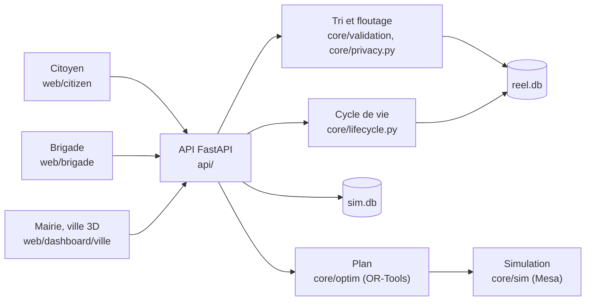

# Rapport Technique de Yilgré

**Hackathon des Universités 2026, finale, thème l'Open Source. Sujet 01 « Assainissement de Ouaga ».**
Yilgré (anciennement Ouaga Clean) est un outil libre d'aide à la décision, du signalement des dépotoirs sauvages
jusqu'au plan de gestion de la ville, avec une simulation des ménages, des pré-collecteurs, de la brigade Laabal et de
la mairie. Chaque chiffre de ce rapport renvoie au fichier ou à la commande qui le produit.

---

## 1. Contexte

- **Le problème :** à Ouagadougou, les dépotoirs sauvages se forment là où la pré-collecte ne passe pas ou déborde ; la
  mairie, la brigade Laabal et les pré-collecteurs manquent d'une vue commune pour décider où intervenir.
- **La demande du sujet :** cartographier les dépotoirs à partir de signalements vérifiés ; proposer un plan de gestion
  (points de regroupement, tournées) ; simuler les acteurs ; modifier les paramètres (population, abonnements, camions,
  fréquences, budget) et comparer des scénarios ; tenir une épreuve en direct (signalements piégés, panne de camion,
  saison des pluies, nouveau quartier) où le plan se recalcule et reste cohérent.
- **Les contraintes :** code libre, déploiement en une commande, aucune dépendance à des données indisponibles, bien
  commun à la sortie (carte ouverte des dépotoirs, simulateur réutilisable par d'autres communes).

---

## 2. Démarche

1. **Audit du dépôt** (18 novembre) : état réel, écarts avec les livrables et avec les décisions de l'équipe.
2. **Moteur de plan :** correction de la demande (population calée sur la part de surface), découpage des points plus
   lourds qu'un camion, indicateur global honnête `checks.ok`.
3. **Back-end complet :** deux bases séparées, cycle de vie, codes par rôle, tri en alertes, floutage, crises de
   l'épreuve en direct, Mesa réel, exports ouverts, déploiement HTTPS en une commande, deuxième commune.
4. **Front :** page citoyen hors connexion, page brigade, ville 3D de la mairie (modes Réel et Simulation), vue 2D de
   secours, mode démonstration explicite.
5. **Intégration et recette :** contrat front / back vérifié automatiquement, parcours complet testé dans un navigateur,
   recette depuis un clone neuf.

Les décisions fonctionnelles de l'équipe (statuts, rôles, tri non décideur, séparation réel / simulé) servent de
référence ; chacune est appliquée dans le code et vérifiée par un test (`tests/`).

---

## 3. Architecture

- **Données géographiques :** réseau routier, bâtiments et eau d'OpenStreetMap, préparés une fois et versionnés
  (`data/processed/`, 3,7 Mo pour le graphe routier) ; un clone neuf a donc un plan sans téléchargement.
- **Deux bases :** `reel.db` et `sim.db`, même schéma, ouvertes par `core/db.get_db(mode)` sans jointure possible.
- **Configuration :** un seul fichier par commune, lu par le seul module `core/config.py` (variable `COMMUNE_CONFIG`).
- **Front :** HTML, CSS et JavaScript natifs, Three.js et Leaflet copiés localement, sans étape de construction.

---

## 4. Choix Techniques

| Choix | Raison | Alternative écartée |
|---|---|---|
| **OR-Tools** pour les tournées, limite de 5 s (config) | solveur libre éprouvé de tournées avec capacités | heuristique maison seule (gardée en secours) |
| **OSMnx** pour préparer le réseau, **SciPy** pour les plus courts chemins | réseau OSM fidèle ; SciPy 16 fois plus rapide que NetworkX ici (section 7) | appels Overpass à chaque calcul |
| **Bâtiments OSM** | denses à Ouagadougou, même chaîne que les routes, licence claire (ODbL) | Open Buildings, non intégré faute de temps |
| **Mesa 3.5.2**, un seul modèle | cadre libre de simulation multi-agents ; coefficients dans la configuration | modèle maison sans cadre |
| **Tri aide, jamais décideur** | seule la brigade décide ; le tri écarte l'impossible et pose des alertes | statut accepté / rejeté calculé |
| **Deux bases réel / simulation** | aucun cas fictif ne peut contaminer un export ou un plan réel | colonne « source » dans une seule base |
| **Floutage côté serveur avant stockage** (OpenCV) | la photo brute n'est jamais écrite ; un seul endroit à auditer | floutage dans le navigateur, contournable |
| **Ville 3D Three.js sur emprises OSM** | lien direct entre la carte, les tournées et les données | carte 2D inclinée |

---

## 5. Paramètres

Les paramètres modifiables et leurs bornes sont dans `config/commune_config.json` (sections `params` et `bounds`) et
dans le tableau du [README](../README.md#8-configuration). Par défaut : 3 000 000 habitants, 40 % d'abonnés à la
pré-collecte, 10 camions de 5 000 kg (3 tournées par jour), 20 tricycles, 3 passages par semaine, budget de
10 000 000 FCFA par jour de collecte. Une valeur hors bornes est ramenée à la borne avec un avertissement.

Les coefficients de la simulation (probabilités de dépôt sauvage, de passage des tricycles, de sensibilisation par la
brigade, effet de la pluie) sont dans la section `hypotheses`, chacun étiqueté « hypothèse non mesurée » et recopié dans
chaque résultat de simulation. Ce sont des hypothèses de travail à valider avec la mairie.

---

## 6. Scénarios Simulés

Source : [docs/scenarios.md](scenarios.md), produit par `python -m scripts.scenarios_rapport` (simulation de 7 jours,
graine 0). Les colonnes de simulation reposent sur les hypothèses non mesurées de la section 5.

| Scénario | Mode | Points servis | Reportés | Coût d'un passage (FCFA) | Calcul (ms) | Part ramassée, 7 j (simulée) |
|---|---|---|---|---|---|---|
| Défaut | complet | 29/29 | 0 | 191 827 | 290 | 34,7 % |
| Panne d'un camion | partiel | 29/29 | 0 | 191 826 | 40 | 31,6 % |
| 6 camions | complet | 29/29 | 0 | 190 635 | 258 | 24,9 % |
| 6 camions + panne | partiel | 25/29 | 4 | 164 191 | 43 | 22,7 % |
| Saison des pluies | complet | 28/29 (1 non desservi) | 0 | 228 481 | 263 | 29,3 % |
| Pluie + quartier Kalgodin | complet | 37/37 | 0 | 289 382 | 386 | 25,1 % |
| Quartier Paglayiri | complet | 37/37 | 0 | 239 944 | 391 | 27,5 % |

Lecture :
- **Panne :** avec 10 camions, la flotte absorbe la panne (aucun point perdu), mais la simulation, qui tient compte d'un
  camion de moins, ramasse moins. Avec 6 camions, la panne reporte 4 arrêts au passage suivant.
- **Pluie :** les voies non revêtues coûtent plus (distance de 127,9 à 152,3 km) et un point devient inaccessible.
- **Part ramassée :** elle reste sous 40 % parce que 60 % des ménages ne sont pas abonnés à la pré-collecte
  (hypothèse de départ) ; ce chiffre mesure le modèle, pas la ville.

Les durées de calcul varient d'un passage à l'autre ; elles restent sous la limite de 5 s du solveur.

---

## 7. Résultats Mesurés

Source : [docs/mesures.md](mesures.md), produit par `python -m scripts.bench` (Intel i3-1115G4, 4 cœurs, sans carte graphique).

| Mesure | Avant | Après |
|---|---|---|
| Dijkstra depuis 60 sources | 0,89 s (NetworkX) | 0,06 s (SciPy) |
| Placement des points (k = 46) | 0,13 s sur les bâtiments | 0,03 s sur des cellules de 100 m, même couverture |
| Matrice 29 × 29 | 0,027 s à froid | 0,000 s avec le cache |
| Panne d'un camion | 0,31 s (complet) | 0,05 s (partiel) |
| 100 / 1 000 / 10 000 signalements | 4,77 / 5,28 / 8,80 s | 1,38 / 1,03 / 1,46 s |

Avec 100 signalements, la présélection dessert 67 points sur 92 contre 70 sans elle : le gain de temps a un coût.

- **Floutage** (même fichier, `python -m scripts.bench_blur`) : 7 images libres de droits, 8 visages couverts sur 8,
  3 plaques sur 4 ; la plaque manquée remplit toute l'image. Aucun taux général n'est déduit de 7 images.
- **Tests :** 128 tests pytest ; parcours dans Chromium par `./scripts/verifier_tout.sh` : chaîne complète citoyen >
  brigade > mairie (11 vérifications), tableau de bord 3D (24), gestes (5), commune (5), citoyen, brigade, couche
  API, vue 2D sans WebGL, mode démonstration ; tous réussis le 2026-11-18.
- **Ville 3D :** 49 738 bâtiments et 12 408 tronçons de route (`web/dashboard/ville/data/city.json`, champ `meta`) ;
  chargement mesuré à 2,1 s dans Chromium en rendu logiciel. Aucune mesure sur une carte graphique.

---

## 8. Plan de Gestion de la Zone Pilote

Source : [docs/scenarios.md](scenarios.md), section « Plan de gestion par défaut ».

- **Zone :** le secteur pilote, carré de 5 km au centre de Ouagadougou (`data/secteur.geojson`).
- **Points de regroupement :** 29, placés par KMeans pondéré sur les bâtiments puis recalés sur le réseau routier.
- **Tournées :** 18 trajets répartis sur 6 camions (3 trajets chacun), 127,9 km par passage, 79,3 t collectées par
  passage, coût d'un passage 191 827 FCFA, tous les points desservis.
- **Non collecté :** 118,9 t par passage, produites par les ménages non abonnés : le levier principal est
  l'abonnement à la pré-collecte, pas le nombre de camions (4 camions sur 10 restent libres).
- **En cas de crise :** panne absorbée par recalcul partiel ; pluie et nouveau quartier recalculés en
  moins d'une seconde (section 6).

---

## 9. Limites

1. **Couverture :** secteur pilote et deux quartiers (Kalgodin, Paglayiri) ; Tampouy sans bâtiments ; Koudougou en
   mode secours faute de données routières préparées.
2. **Ville 3D :** emprises OSM, hauteurs estimées (27 bâtiments sur 49 738 ont une hauteur dans OSM), arbres
   illustratifs.
3. **Population :** répartie à la surface (densité supposée uniforme).
4. **Tricycles :** réseau construit, tournées non optimisées.
5. **Simulation :** coefficients non mesurés ; résultats à lire comme des tendances comparées, pas des prévisions.
6. **Floutage :** fiabilité limitée, surtout pour les plaques ; mesurée sur 7 images seulement.
7. **Envoi citoyen :** sans clé d'idempotence ; un renvoi peut renforcer deux fois le même dépotoir.
8. **Certificat auto-signé :** le service worker est refusé ; la page citoyen ne se rouvre pas sans réseau.
9. **Mesures :** une seule machine, sans carte graphique ; aucune comparaison avec Kutɔnu Vibes.
10. **Jeu de signalements ouvert :** l'export fonctionne, mais il ne contient pas encore de signalements réels confirmés
    sur le terrain ; les cas de démonstration sont synthétiques et restent dans `sim.db`.

---

## 10. Suites Possibles

- Clé d'idempotence sur l'envoi citoyen ; certificat reconnu pour le service worker.
- Tournées des tricycles ; intégration d'Open Buildings ; données de toute la commune.
- Calibrage des hypothèses de simulation avec la mairie et la brigade Laabal.
- Collecte de vrais signalements dans le secteur, puis versement relu dans OpenStreetMap.
